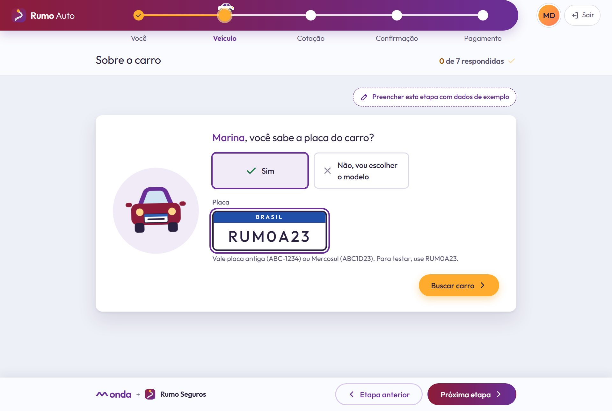
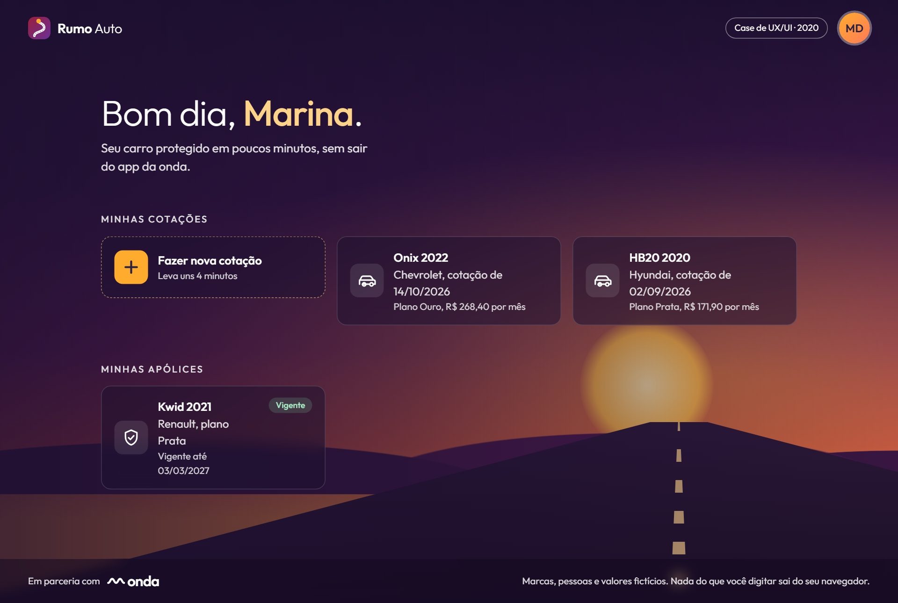
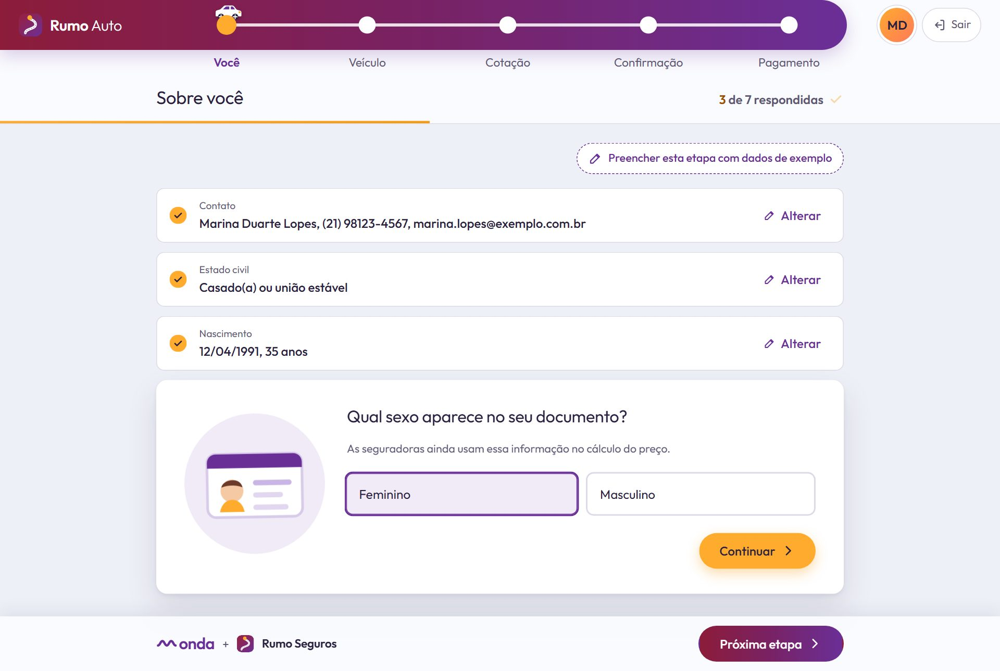
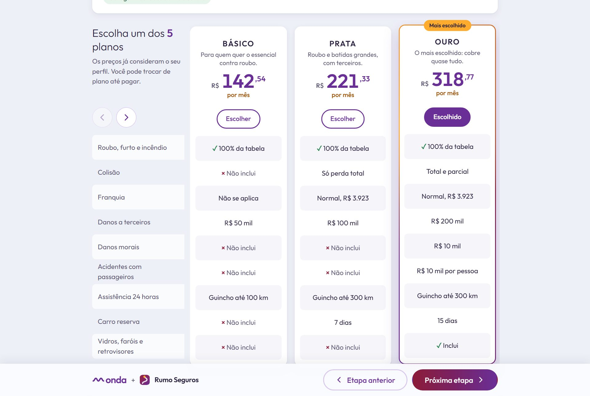
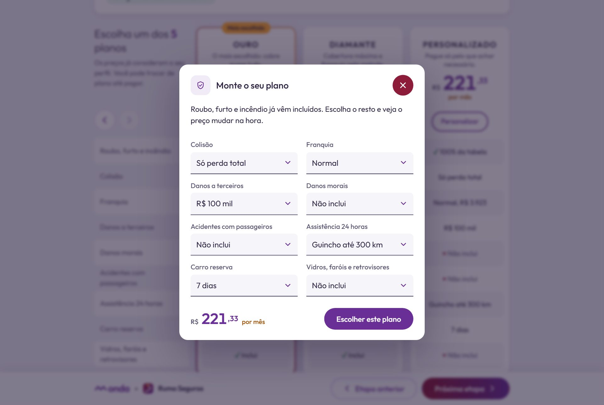
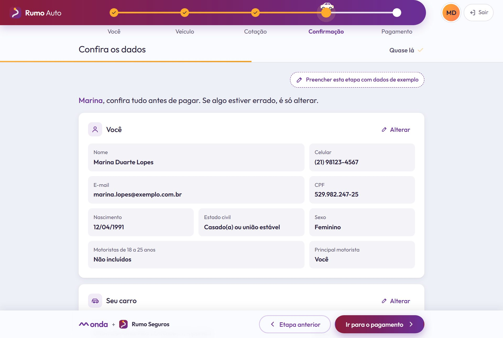
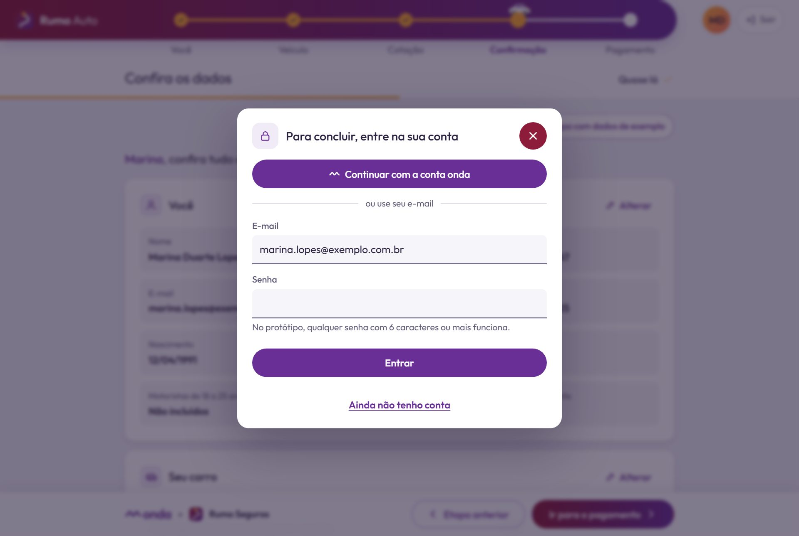
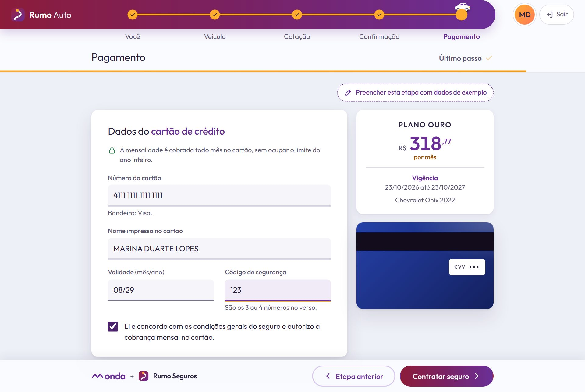
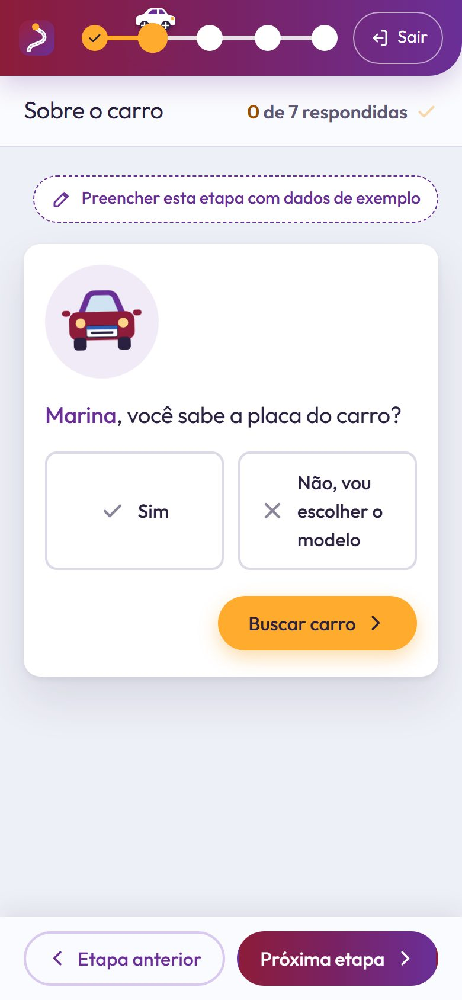
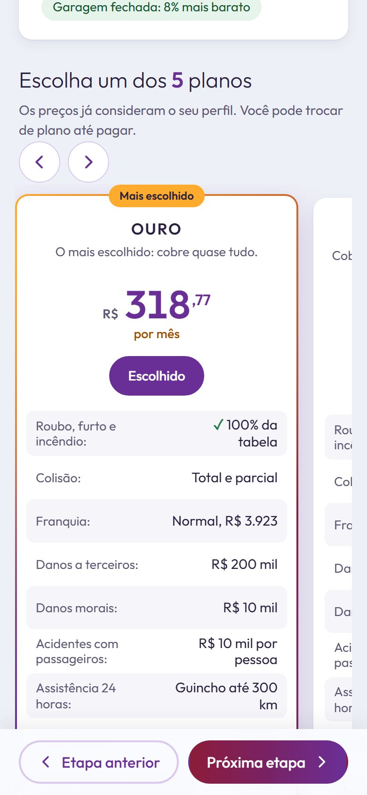

<div align="center">


# Rumo Auto

**Case de UX/UI e front-end: cotação e contratação de seguro auto em conversa, dentro do app de uma operadora.**

[](https://github.com/fernandopinhel/rumo-seguro-auto/actions/workflows/ci.yml)


[Ver o protótipo](https://fernandopinhel.github.io/rumo-seguro-auto/) ·
[Como rodar](#como-rodar-localmente) ·
[O case](#o-case)



</div>

> **Este é um case de portfólio.** O projeto nasceu em 2020, numa empresa onde trabalhei,
> e foi recriado aqui para mostrar o processo e o resultado. Para preservar a empresa e os
> clientes, a interface usa duas marcas fictícias: a seguradora **Rumo Seguros** e a
> operadora **onda**. Pessoas, placas, CEPs, valores de tabela e preços são de exemplo, e
> nada do que você digita sai do seu navegador.

---

## Sumário

- [O case](#o-case)
  - [Contexto e problema](#contexto-e-problema)
  - [Objetivo](#objetivo)
  - [Decisões de design](#decisões-de-design)
  - [Modernizar sem perder a identidade](#modernizar-sem-perder-a-identidade)
  - [Os efeitos, e por que eles existem](#os-efeitos-e-por-que-eles-existem)
  - [As marcas fictícias](#as-marcas-fictícias)
  - [Revisitando o case](#revisitando-o-case)
- [A jornada, tela a tela](#a-jornada-tela-a-tela)
- [O que funciona no protótipo](#o-que-funciona-no-protótipo)
- [Acessibilidade](#acessibilidade)
- [Tecnologias e arquitetura](#tecnologias-e-arquitetura)
- [Como rodar localmente](#como-rodar-localmente)
- [Publicação no GitHub Pages](#publicação-no-github-pages)
- [Segurança e privacidade](#segurança-e-privacidade)
- [Limitações](#limitações)
- [Próximos passos](#próximos-passos)
- [Histórico](#histórico)
- [Autor](#autor)

---

## O case

### Contexto e problema

Uma seguradora queria vender seguro auto dentro do app de uma operadora de telefonia, para
clientes que muitas vezes nunca tinham feito uma cotação sozinhos. O caminho tradicional era
um formulário de corretor: dezenas de campos numa tela só, termos como "franquia", "APP" e
"danos corporais" sem explicação, e uma tabela de planos em que só se via o preço no fim.

Para quem chegava pelo app, isso significava:

- desistir no meio, sem saber quanto faltava;
- não entender por que a seguradora pergunta estado civil, sexo ou onde o carro dorme;
- comparar planos sem saber o que cada cobertura cobre;
- perceber só no pagamento que tinha errado um dado lá no começo.

### Objetivo

Transformar a cotação numa **conversa curta**, em que a pessoa:

1. responde **uma pergunta por vez**, com uma ilustração e uma frase de contexto;
2. vê o que já respondeu e **altera qualquer resposta** sem perder o resto;
3. sabe sempre **em que etapa está e quanto falta**;
4. compara **5 planos lado a lado**, ou monta o seu, com o preço mudando na hora;
5. confere tudo num **resumo** antes de pagar.

### Decisões de design

| Decisão | Por quê |
| --- | --- |
| **Uma pergunta por cartão** | Reduz a carga de cada passo. A pergunta tem o nome da pessoa ("Marina, você sabe a placa do carro?") e uma ilustração, então parece conversa, não formulário. |
| **O fio da conversa** | Cada resposta vira uma linha compacta acima da pergunta atual, com "Alterar". A pessoa vê o caminho percorrido e corrige sem voltar etapas. |
| **Contador "3 de 7 respondidas"** | Já existia no original, mas era fixo. Agora conta de verdade e muda quando uma resposta abre ou fecha perguntas (o motorista principal só aparece se não for a própria pessoa). |
| **Dica do porquê** | Perguntas sensíveis explicam o motivo: sexo "ainda entra no cálculo do preço", principal motorista é quem "usa o carro em pelo menos 85% do tempo". |
| **Aviso na hora certa** | Recusar a cobertura para motoristas de 18 a 25 anos abre um diálogo com a regra e pede confirmação. A pessoa decide sabendo o que perde, e pode mudar para "sim" ali mesmo. |
| **Placa Mercosul desenhada** | O campo tem a cara de uma placa, aceita o formato antigo e o novo, e a busca devolve as versões do carro com o valor de tabela. Quem não sabe a placa escolhe marca, modelo e ano. |
| **CEP preenche o endereço** | Só número e complemento ficam para a pessoa. Se o CEP não for encontrado, os campos abrem vazios em vez de travar. |
| **"O que pesou no preço"** | Na cotação, etiquetas mostram os ajustes do perfil ("Garagem fechada: 8% mais barato", "Motorista de aplicativo: 28% mais caro"). O preço deixa de ser uma caixa-preta. |
| **Matriz de planos com rótulos fixos** | No desktop, as coberturas ficam numa coluna à esquerda, como no original, e os planos rolam ao lado. No celular, cada cartão traz os rótulos dentro. |
| **"Não inclui" em vez de traço** | O original usava "-" para coberturas ausentes. Escrever "Não inclui", com um × discreto, deixa a comparação legível e acessível. |
| **Plano personalizado com preço ao vivo** | O "Recalcular" do original virou cálculo instantâneo a cada escolha. A franquia só aparece quando há colisão. |
| **Login só no fim** | Pedir conta antes de mostrar o preço afasta. A conta é pedida entre a confirmação e o pagamento, com "Continuar com a conta onda" em um toque. |
| **Cartão que vira** | O cartão desenhado mostra o que está sendo digitado, reconhece a bandeira e gira para o verso no código de segurança. |

### Modernizar sem perder a identidade

A revisão manteve os elementos que davam personalidade ao protótipo de 2020 e trabalhou o
acabamento em volta deles:

| Elemento original | O que ficou | O que mudou |
| --- | --- | --- |
| Faixa vinho para roxo no topo, com ponta arredondada | Mesma faixa, mesmo gradiente | Marca fictícia, sombra suave e versão de celular que ocupa a largura toda |
| Carrinho andando sobre a linha das etapas | O carrinho, a linha laranja e os pontos brancos | Ele dirige até a etapa nova, com rodas girando e fumaça, e dá ré quando a pessoa volta |
| Rótulos das etapas abaixo da faixa | Iguais | A etapa atual muda de verdade (no original, "Cliente" ficava sempre ativo) e cada uma diz seu estado para leitores de tela |
| Tela inicial escura sobre foto de pôr do sol | O pôr do sol, a estrada e os blocos translúcidos | A foto virou cena em CSS, com sol pulsando e faixas da estrada correndo |
| Cartões brancos com ilustração à esquerda | Iguais | Ilustrações redesenhadas no mesmo estilo flat, todas num círculo, flutuando de leve |
| Campos sublinhados com texto leve | O sublinhado | Rótulo visível acima do campo, fundo suave e sublinhado laranja no foco |
| Botões "Sim" e "Não" com ✓ e × | Iguais | O ✓ fica verde e o × gira ao marcar |
| Botão "OK" laranja em pílula | Igual | Agora diz o que faz: "Continuar", "Buscar carro", "Ver minha cotação" |
| Planos Nudo, Prata, Ouro, Diamante e Personalizado em carrossel | Cinco planos e as setas (o Nudo virou Básico) | Preços e coberturas diferentes de verdade, selo "Mais escolhido" e borda em gradiente que gira no plano escolhido |
| Preço grande em roxo com centavos em sobrescrito e "mensalidade" em laranja | Igual | Os números sobem até o valor ao abrir a cotação |
| Resumo em ladrilhos cinza | Iguais | Agrupados (você, motorista, carro, plano), cada grupo com "Alterar" |
| Cartão de crédito desenhado ao lado do formulário | Igual | Cor da bandeira, número ao vivo e giro para o verso |
| Modal "Seguro contratado com sucesso!" em gradiente | O gradiente e o título | Número da apólice, vigência, comprovante para baixar e o carro chegando ao escudo |

### Os efeitos, e por que eles existem

Cada efeito responde a uma pergunta da pessoa, e nenhum é decoração solta:

- **"Onde eu estou?"** O carrinho dirige até a etapa nova. Voltar uma etapa engata a ré.
- **"Isso foi salvo?"** A resposta encaixa no fio com um pequeno salto, e o ✓ do contador acende quando a etapa fecha.
- **"Qual plano está valendo?"** A borda do plano escolhido gira em gradiente vinho, roxo e laranja (com `@property`, sem JavaScript).
- **"O que vou digitar atrás do cartão?"** O cartão gira para o verso no código de segurança.
- **"Deu certo?"** No sucesso, o carro entra no escudo com confete nas cores da marca.

Tudo isso é desligado com `prefers-reduced-motion`.

### As marcas fictícias


**Rumo Seguros** é a seguradora do case. O símbolo é **uma estrada em curva que termina num
ponto laranja**, o destino: a mesma estrada do topo, onde o carrinho anda. Ele também é o
favicon. **onda** é a operadora parceira, com uma onda no lugar do sinal, que empresta o
roxo da ponta da faixa.

<br clear="left">

### Revisitando o case

Em 2026 o protótipo foi revisitado:

- **A identidade visual foi preservada** e o acabamento foi modernizado (veja a tabela acima).
- **Tudo funciona de ponta a ponta**: perguntas com validação, busca por placa ou por modelo, CEP, cálculo de preço, planos, personalização, confirmação, conta, pagamento e apólice nova na tela inicial.
- **Conteúdo corrigido**: os campos "Confirmar telefone" e "Confirmar e-mail" saíram (a pessoa vê tudo na confirmação), a cliente era "Julia" numa tela e "Juliana" em outra, todos os planos tinham o mesmo preço e as mesmas coberturas, as descrições eram *lorem ipsum*, os selects tinham "Modelo A, B, C", havia "estaciomento" e "extraordiárias", e o título "Dados do Cliente" aparecia em todas as abas.
- **Login sem redes sociais**: os botões de Facebook e Google deram lugar à conta do próprio app parceiro, que é o que faz sentido dentro dele.
- **Acessibilidade revisada para a WCAG 2.2 AA** e verificada com axe em todos os estados.
- **Zero dependências de runtime**: saíram Bootstrap, jQuery, Popper, o datetimepicker com seus arquivos de idioma, o Font Awesome, as fontes locais, as cópias de segurança duplicadas e as imagens com marcas reais, cerca de 3.600 arquivos e 43 MB.

---

## A jornada, tela a tela

```
Início ───► Você ───► Veículo ───► Cotação ───► Confirmação ───► Pagamento ───► Apólice
(escuro)    8 perguntas  7 perguntas  5 planos    resumo + conta    cartão          na tela inicial
```

| Tela inicial | A conversa |
| --- | --- |
|  |  |

| Planos | Plano personalizado |
| --- | --- |
|  |  |

| Confirmação | Conta |
| --- | --- |
|  |  |

| Pagamento | Sucesso |
| --- | --- |
|  |  |

| Celular: pergunta | Celular: planos |
| --- | --- |
|  |  |

| Etapa | O que a pessoa faz |
| --- | --- |
| **Início** | Vê as cotações e a apólice que já tem, retoma uma cotação ou começa outra. |
| **Você** | Contato, estado civil, nascimento, sexo, CPF, motoristas de 18 a 25 anos, principal motorista e, se for outra pessoa, os dados dela. |
| **Veículo** | Placa (ou marca, modelo e ano), versão do carro, uso, CEP de onde dorme, onde fica à noite, financiamento, blindagem, kit gás e início da vigência. |
| **Cotação** | Vê o valor do carro e o que pesou no preço, compara 5 planos e escolhe um, ou monta o seu. |
| **Confirmação** | Confere tudo, altera o que precisar e informa o endereço de cobrança. Entra na conta. |
| **Pagamento** | Cartão de crédito e aceite das condições. A apólice aparece na tela inicial. |

---

## O que funciona no protótipo

- **Conversa**: uma pergunta aberta por vez, respostas no fio com "Alterar" e retorno à confirmação depois de alterar um dado de lá.
- **Perguntas que dependem de outras**: "principal motorista: não" abre os dados do motorista; trocar a placa invalida a versão escolhida antes.
- **Regras**: CPF com dígitos verificadores (e diferente do seu para o motorista), datas que existem no calendário, idade entre 18 e 100 anos, nome e sobrenome, celular com DDD e 9 dígitos, e-mail, placa nos dois formatos, CEP, início da vigência entre hoje e 30 dias, cartão pelo algoritmo de Luhn, validade não vencida e CVV com 3 ou 4 dígitos conforme a bandeira.
- **Máscaras** de celular, data, CPF, CEP, cartão e validade.
- **Busca pela placa** (teste com `RUM0A23`, que traz duas versões) ou por marca, modelo e ano, com o valor de tabela ajustado ao ano.
- **CEP** que preenche rua, bairro, cidade e estado (teste com `22041-011`).
- **Preço** calculado a partir do valor do carro, das coberturas e do perfil: uso, pernoite, motoristas jovens, blindagem, kit gás e idade.
- **Planos** com coberturas e franquia em reais, rolagem com setas e plano personalizado com preço ao vivo.
- **Conta**: entrar com a conta onda, com e-mail e senha, ou criar conta.
- **Cartão**: bandeira reconhecida pelo número (Visa, Mastercard, Elo e American Express) e cartão desenhado ao vivo. Teste com `4111 1111 1111 1111`.
- **Apólice**: número, vigência, comprovante em `.txt` gerado no navegador e apólice nova destacada na tela inicial.
- **Rascunho**: recarregou a página? O fluxo volta na mesma etapa. Saiu? "Continuar cotação" aparece na tela inicial.
- **Preencher esta etapa com dados de exemplo** completa a etapa atual para quem quer só conhecer o fluxo.

---

## Acessibilidade

O protótipo segue a **WCAG 2.2 nível AA**. Todas as telas e estados (erros, diálogos,
sucesso e celular) foram auditados com [axe-core](https://github.com/dequelabs/axe-core),
sem violações.

- **Estrutura**: `lang="pt-BR"`, link "Pular para o conteúdo", landmarks, um `h1` por tela e títulos em ordem.
- **Etapas**: a estrada é uma lista de botões com `aria-current="step"` e o estado de cada etapa escrito para leitores de tela. O carrinho e a linha são decorativos (`aria-hidden`). O título da aba muda a cada etapa ("Sua cotação (etapa 3 de 5)").
- **Perguntas**: cada cartão é um `fieldset` cuja `legend` é a própria pergunta. Ao responder, o foco vai para a próxima pergunta, e cada resposta salva tem um botão "Alterar" com nome completo ("Alterar data de nascimento").
- **Formulários**: rótulo visível em todos os campos, dicas com `aria-describedby`, `autocomplete` e `inputmode` certos para cada campo, inclusive os de cartão.
- **Erros**: mensagem no campo (`aria-invalid` + `aria-describedby`), foco no primeiro erro e anúncio de quantos faltam. Depois da primeira tentativa, cada erro some assim que é corrigido.
- **Escolhas**: opções em caixa, "Sim e Não" e segmentos são `input type="radio"` nativos, então funcionam com as setas do teclado.
- **Planos**: cada plano é um `article` com título; o botão "Escolher" tem `aria-pressed` e diz o nome do plano. Cada cobertura tem rótulo próprio no cartão. Focar um plano pelo teclado rola o carrossel até ele.
- **Diálogos** com `<dialog>` nativo: prendem o foco, fecham com Esc (exceto o de sucesso, que pede uma escolha) e devolvem o foco a quem abriu.
- **Anúncios** em `aria-live` para o que muda sem trocar de tela: resposta salva, endereço encontrado, bandeira do cartão, plano escolhido.
- **Visual**: contraste de pelo menos 4,5:1 no texto e 3:1 nas bordas dos campos, foco sempre visível, alvos de toque de 44 px e nenhuma rolagem horizontal a 320 px. O CSS respeita `prefers-reduced-motion` e `forced-colors` (alto contraste do Windows).

---

## Tecnologias e arquitetura

| Camada | Tecnologia | Uso |
| --- | --- | --- |
| Marcação | HTML5 | Uma página, sem build. `<dialog>` nativo. |
| Estilo | CSS3, sem framework | `css/app.css`: tokens, estrada, fio da conversa, planos, cartão 3D e cena da tela inicial. |
| Comportamento | JavaScript puro | Utilitários, dados e fluxo em três arquivos, sem jQuery nem Bootstrap. |
| Ilustrações e ícones | SVG próprio | Ilustrações flat em `img/ilustracoes/` e sprite de ícones de traço em `img/icons.svg`. |
| Tipografia | Outfit | Google Fonts, pesos 300 a 600: leve como o Roboto Light do original, com números mais redondos para os preços. |
| Qualidade | HTMLHint + GitHub Actions | Valida o HTML e barra scripts e estilos inline. |
| Deploy | GitHub Pages via Actions | Publica a cada push na `master`. |

```
.
├── index.html              # Tela inicial, as 5 etapas e os diálogos
├── css/
│   └── app.css             # Estilos do protótipo
├── js/
│   ├── common.js           # Sessão (sessionStorage), anúncios, ícones e diálogos
│   ├── dados.js            # Carros, placas, CEPs, coberturas, planos e dados de exemplo
│   └── cotacao.js          # Conversa, validação, preço, planos, conta, pagamento e apólice
├── img/                    # Símbolo da marca, sprite de ícones e ilustrações
├── docs/screenshots/       # Capturas usadas neste README
└── .github/
    ├── workflows/ci.yml    # Validação de HTML
    ├── workflows/pages.yml # Deploy no GitHub Pages
    └── dependabot.yml      # Atualização das GitHub Actions
```

**Como o fluxo funciona por dentro.** Cada pergunta é um `<li class="pergunta">` com um
`data-estado` (`pendente`, `atual` ou `respondida`) e uma entrada no objeto `Q` de
`js/cotacao.js`, que sabe preencher, validar, salvar e resumir aquela pergunta. O preço soma
o peso de cada nível de cobertura (em `js/dados.js`) sobre o valor do carro e multiplica pelos
ajustes do perfil. Planos, resumo e diálogos são montados com `createElement` e `textContent`.
O rascunho fica no `sessionStorage` com a chave `rumo:rascunho`, e as apólices novas em
`rumo:apolices`.

---

## Como rodar localmente

O projeto é estático: basta servir a pasta com qualquer servidor HTTP. Prefira um servidor
ao `file://`, porque a CSP e o sprite de ícones se comportam de forma diferente com
arquivos locais.

```bash
git clone https://github.com/fernandopinhel/rumo-seguro-auto.git
cd rumo-seguro-auto

# Opção 1: Python
python3 -m http.server 8080

# Opção 2: Node
npx serve .
```

Depois, acesse <http://localhost:8080>, clique em **Fazer nova cotação** e, se quiser ir
rápido, em **Preencher esta etapa com dados de exemplo**.

Para validar o HTML (o mesmo check do CI):

```bash
npx htmlhint@1 "*.html"
```

---

## Publicação no GitHub Pages

O workflow `.github/workflows/pages.yml` publica o site a cada push na `master`. Para ativar:

1. No GitHub, abra **Settings → Pages**.
2. Em **Build and deployment → Source**, escolha **GitHub Actions**.
3. Faça um push na `master` ou rode o workflow em **Actions → Deploy GitHub Pages**.

O endereço será <https://fernandopinhel.github.io/rumo-seguro-auto/>.

---

## Segurança e privacidade

- **Nenhum dado sai do navegador.** Não há back-end. O rascunho fica no `sessionStorage` e some ao fechar a aba. Os dados do cartão nunca são guardados, nem no rascunho, e o formulário é limpo ao contratar.
- **Content Security Policy**: `script-src 'self'`, `style-src` sem `'unsafe-inline'`, `object-src 'none'`, `base-uri 'self'` e `form-action 'self'`. Só o Google Fonts é liberado como origem externa.
- **Sem JavaScript nem CSS inline.** O CI barra `<script>` inline, handlers `on*=` e atributos `style=`.
- **Sem injeção de HTML.** Planos, resumo e diálogos são montados com `createElement` e `textContent`, nunca com `innerHTML`.
- **Sem bibliotecas de terceiros no runtime.** O número da apólice usa `crypto.getRandomValues`.
- **Referrer Policy** `strict-origin-when-cross-origin` e `noindex` para buscadores.
- **CI com permissões mínimas** (`contents: read`) e Dependabot para as Actions.

O GitHub Pages não permite definir cabeçalhos HTTP, por isso a CSP vai em `<meta>` e
`frame-ancestors` não se aplica. Veja também o [SECURITY.md](SECURITY.md).

---

## Limitações

- É um **protótipo**: não há back-end, consulta real de placa ou CEP, análise de risco, cobrança nem emissão de apólice de verdade.
- Preços, valores de tabela, coberturas e condições são fictícios e não são oferta de seguro.
- A busca por placa reconhece três placas de teste; qualquer outra placa válida devolve um carro fixo do catálogo de exemplo.
- Os dados vivem só na aba do navegador.
- As marcas Rumo Seguros e onda são fictícias. O repositório **não tem licença de código aberto**.

---

## Próximos passos

- [ ] Testes de fluxo (Playwright) e auditoria de acessibilidade (axe) no CI.
- [ ] Vistoria prévia pelo celular para carros sem seguro anterior.
- [ ] Bônus de classe vindo de outra seguradora.
- [ ] Pagamento por Pix e débito na conta da operadora.
- [ ] Comparar dois planos lado a lado, com as diferenças destacadas.

---

## Histórico

### 2026-10: Case revisitado

- Marcas fictícias Rumo Seguros e onda no lugar das marcas originais, e nomes de pessoas inventados.
- Identidade visual preservada (faixa vinho para roxo, carrinho na estrada, cartões com ilustração, botões laranja, matriz de planos, cartão de crédito desenhado, sucesso em gradiente) e acabamento modernizado.
- Reescrita em HTML, CSS e JavaScript puros, com fluxo funcional de ponta a ponta.
- Ilustrações redesenhadas em SVG próprio.
- Correções de conteúdo: campos de confirmação duplicados, nome da cliente trocado entre telas, planos iguais, textos de exemplo, opções genéricas nos selects, erros de digitação e título fixo nas abas.
- Acessibilidade revisada para a WCAG 2.2 AA, verificada com axe.
- Saíram Bootstrap, jQuery, Popper, o datetimepicker, o Font Awesome, as fontes locais, as cópias de segurança e as imagens com marcas reais (cerca de 3.600 arquivos e 43 MB).
- CI, deploy no GitHub Pages, Dependabot e `SECURITY.md`.

### 2020-02: Versão original

Protótipo navegável criado na empresa onde o projeto nasceu, com Bootstrap e jQuery.

---

## Autor

**Fernando Pinhel**, Fullstack Designer (UX/UI, Design Systems e Front-end)
[fernandopinhel.com.br](https://fernandopinhel.com.br) · [GitHub](https://github.com/fernandopinhel)
